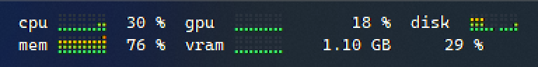

# TrafficMonitor (mod)

A personal build of [TrafficMonitor](https://github.com/zhongyang219/TrafficMonitor) by zhongyang219, the Windows app that shows network speed, CPU, memory, GPU and disk usage in the taskbar. This fork adds btop-style history graphs, warning colours, crash fixes and lower idle CPU.



- Branch `mod` (this one) holds the changes. Branch `master` mirrors upstream unchanged.
- Upstream's own documentation still applies: [English README](README_en-us.md) · [简体中文](README_zh-CN.md) · [FAQ](Help_en-us.md).
- This is a personal fork. It is not affiliated with or supported by the original author, so please report problems with this build here, not upstream.

## What's new

### Taskbar look

- **Braille history graphs.** Each item gets a small scrolling graph between its label and its value, drawn with braille characters as [btop](https://github.com/aristocratos/btop) does. One character holds two seconds of history at four heights.
- **Colour by height.** Dot rows run green → yellow-green → yellow → orange from bottom to top, and the top row turns red at the critical level. A faint grid of empty dots shows the graph's full height, so a steady value reads as a level, not a solid bar.
- **Warning colours.** CPU, memory, GPU, disk and VRAM values turn orange and then red at thresholds you set.
- **VRAM percentage.** The new GPU-memory item reads the adapter's total from DXGI, so it gets a graph and warning colours like the other items. On integrated graphics the total is the shared memory Windows lets the GPU borrow, the same number Task Manager shows.
- **Grouped layout.** Network, CPU + memory, GPU + VRAM and disk stay together in the two-row layout, so hiding one item no longer reshuffles the rest.

### Fixes and speed

- **Crash and data-loss fixes** from four open upstream pull requests: [#2417](https://github.com/zhongyang219/TrafficMonitor/pull/2417) (heap corruption when network adapters change), [#2425](https://github.com/zhongyang219/TrafficMonitor/pull/2425) (lost history record), and [#2414](https://github.com/zhongyang219/TrafficMonitor/pull/2414) and [#2390](https://github.com/zhongyang219/TrafficMonitor/pull/2390) (bounds checks).
- **Accurate network speed.** 64-bit interface counters and a monotonic clock stop the speed from wrapping or jumping.
- **Lower idle CPU.** An event-driven worker thread, and the taskbar strip repaints only when data changes.
- **Less memory in GDI mode.** The Direct2D/Direct3D stack is never loaded when it isn't used.
- **Task-Manager-style GPU usage.** GPU usage is the busiest engine, as Task Manager reports it.

The new features cost no measurable CPU: in three alternating one-minute runs, the median was 875 ms of CPU per minute for this build and 1015 ms for the version before the graphs.

## Settings

The new options live in `config.ini`, in the `[task_bar]` section. They have no settings-dialog UI yet; edit them with TrafficMonitor closed, because it rewrites the file on exit.

| Key | Default | Meaning |
|---|---|---|
| `braille_graph` | `false` | Show the braille history graphs |
| `braille_graph_length` | `5` | Graph width in characters (2–20); each character holds 2 seconds |
| `braille_graph_network` | `true` | Also graph upload and download speed |
| `usage_alert_colors` | `true` | Colour values and graphs by usage level |
| `usage_warning_threshold` | `70` | Percent at which values turn orange |
| `usage_critical_threshold` | `90` | Percent at which values turn red |
| `group_related_items` | `true` | Keep related items together in the two-row layout |

The graphs need a monospace font that contains braille characters, such as Cascadia Mono or a Nerd Font like `CaskaydiaCove NF`. Set it under Options → Taskbar settings → Font.

The build in the screenshot also uses plain text labels (`cpu`, `mem`, `gpu`, `vram`, `disk`), white text, and a warning threshold of 80. Those are ordinary settings, not code.

## Building

There are no prebuilt releases; build it yourself. Tested with Visual Studio 2026 (v18) and the v145 toolset. From PowerShell in the repository root:

```powershell
$env:NoDefaultCurrentDirectoryInExePath = $null   # the pre-build script fails without this
& "C:\Program Files\Microsoft Visual Studio\18\Community\MSBuild\Current\Bin\amd64\MSBuild.exe" `
    TrafficMonitor\TrafficMonitor.vcxproj `
    /p:Configuration="Release (lite)" /p:Platform=x64 /p:PlatformToolset=v145 /m /v:minimal
```

- Build the `.vcxproj`, not the `.sln`. The solution build currently fails with a missing `.metaproj` error.
- The output is `TrafficMonitor\Bin\x64\Release (lite)\TrafficMonitor.exe`.
- `Release (lite)` leaves out temperature monitoring, which needs administrator rights. Use `Release` for the full version.

## Credits and license

TrafficMonitor is written by [zhongyang219](https://github.com/zhongyang219) and released under the "Anti 996" License; see [LICENSE](LICENSE). This fork keeps that license. The merged pull requests are by their authors, credited in the commit history.
